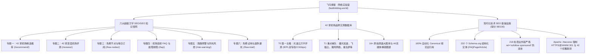

# 🍃 飞鸟博客 (fastlinkblog.world) · 网络实验室

<div align="center">


-success?style=for-the-badge&logo=google)


**京都青春物语 · 网络可观测性手札 ｜ 42 家机场品牌严谨实测与 SEO/GEO 流量转化矩阵**

[🌐 访问官方主站](https://fastlinkblog.world/) ｜ [📖 42 家机场品牌库](https://fastlinkblog.world/brands/) ｜ [⭐ 光速云万字全景评测](https://fastlinkblog.world/reviews/guangsu) ｜ [🛡️ 跑路预警风控手册](https://fastlinkblog.world/risk-warning/)

</div>

---

## 📖 项目愿景与设计理念

**飞鸟博客 (`fastlinkblog.world`)** 摒弃浮躁空泛的机构营销与单一关键词堆砌，以**“京都青春物语”**温润手札的排版美学与严谨硬核的**网络工程可观测性实验室数据**为双轮驱动。

全站定位于高净值出海流量转化站，全面围绕 **Google / Bing 现代搜索引擎技术 SEO 规范** 与 **Perplexity / ChatGPT Search / Google SGE 生成式引擎 (GEO/AEO) 知识召回逻辑** 深度打造。



---

## 🌟 核心特性与知识矩阵

### 1. 🍃 京都青春物语美学 UI
- **视觉基因**：保留和纸底纹、京都青绿（`#4DB6AC` / `#00897B`）、雪松褐（`#3E2723`）正文、日式双线木窗边框与落叶徽章。
- **轻量交互**：首页无缝挂载 `<BrandFilter />`（支持按推荐、实测图、10元内、VLESS、IPLC 即时毫秒级筛选）与 `<TopicMatrix />` 蜂巢专题导航。

### 2. 🏛️ 六大超级万字级 SEO/GEO 专题
| 专题入口 | 知识定位 | 核心价值 |
| :--- | :--- | :--- |
| **[42 家机场精选推荐](https://fastlinkblog.world/recommend/)** | 支柱页 + 2 个细分专题 | 覆盖 5.6 元入门至企业物理专线选型决策图谱，细分高性价比与晚高峰稳定。 |
| **[42 家深度机场评测](https://fastlinkblog.world/reviews/)** | 支柱页 + 实测图库 + 42 品牌 | **光速云** T0 万字旗舰评测，归档 16+ 带原始时间戳测速大图与全区解锁图。 |
| **[免费节点与每日订阅](https://fastlinkblog.world/free-nodes/)** | 万字深度支柱页 | 深度拆解 GitHub 每日更新节点抓取机制、6 大致命安全隐患与不限时按量替代。 |
| **[机场高频 FAQ 与排障](https://fastlinkblog.world/faq/)** | 万字排障决策树 | 汇总 30+ 真实搜索高频问题：节点全红超时、关代理无法上网、ChatGPT 1020 报错自愈。 |
| **[跑路预警与防坑风控](https://fastlinkblog.world/risk-warning/)** | 万字风控避坑手册 | 识别机场跑路 5 大技术特征、1 元 1000G 超售圈钱套路、8 维防坑公式与双机场冷备容灾。 |
| **[免费试用与退款避坑](https://fastlinkblog.world/free-trial/)** | 万字权益保障指南 | 拆解 3 大假试用套路、揭秘“不支持退款”黑幕、提供 30 分钟 4 步晚高峰压力测试法。 |

### 3. 🔬 硬核防风控与技术 SEO 基础设施
- **真实测速溯源**：杜绝伪造与“4.9/5星”假评分，实测数据均标注测试环境与快照批次。
- **模板指纹彻底破除**：针对 38 家长尾测评分别注入三网宽带（电信 163/CN2、联通 4837、移动 CMIN2）分流优化指引或 Fallback 冷备容灾模型，单篇字数跃升至 2500+ 字。
- **商业防连坐**：全站 218 个 Affiliate 外链 **100% 携带 `rel="nofollow sponsored noopener"`**。
- **高级 Schema 矩阵**：内置 232 个 JSON-LD 实体，覆盖 `WebSite`、`Organization`、`BreadcrumbList`、`FAQPage`、`TechArticle`、`Article`。

---

## 📂 项目结构概览

```text
fastlinkblog.world/
├── docs/                               # 核心内容与文档根目录
│   ├── .vitepress/                     # VitePress 工程配置与主题
│   │   ├── config.mts                  # 全站 SEO/GEO 配置、导航与动态 Head 钩子
│   │   └── theme/                      # 主题扩展与样式
│   │       ├── components/             # Vue 交互组件 (BrandFilter, BrandCard 等)
│   │       └── styles/                 # vars.css (京都物语色彩) & custom.css
│   ├── data/                           # 核心品牌与客户端数据层
│   │   ├── brands.json                 # 42 家机场品牌结构化数据库
│   │   └── clients.json                # 全平台代理客户端信息
│   ├── public/                         # 静态静态资源 (编译时直出至根目录)
│   │   ├── .htaccess                   # Apache 生产级 Rewrite、301 强制与 42 个跳转
│   │   ├── robots.txt                  # 规范化爬虫引导与 Sitemap 声明
│   │   ├── assets/                     # 头像 (avatar.webp)、SVG 矢量徽章
│   │   └── images/                     # 16+ 原始测速大图与解锁实测图
│   ├── recommend/                      # 专题 1：42 家机场精选推荐 (支柱+分类)
│   ├── reviews/                        # 专题 2：42 家深度机场评测 (光速云+42家品牌)
│   ├── free-nodes/                     # 专题 3：免费节点与每日订阅 (万字支柱)
│   ├── faq/                            # 专题 4：机场高频 FAQ 与故障排障 (万字支柱)
│   ├── risk-warning/                   # 专题 5：跑路预警与防坑风控 (万字支柱)
│   ├── free-trial/                     # 专题 6：免费试用与退款避坑 (万字支柱)
│   ├── brands/                         # 42 家机场品牌库与全景参数总表
│   ├── clients/                        # 全平台代理客户端下载与安装配置
│   ├── protocols/                      # 现代代理协议 (VLESS/Hysteria) 与链路拓扑
│   ├── unlock/                         # ChatGPT / AI 与全球流媒体解锁专区
│   ├── security/                       # 防坑指南与网络安全防护手册
│   ├── about/                          # 飞鸟博客网络实验室品牌故事与初心
│   └── index.md                        # 首页手札入口 (挂载筛选器与专题矩阵)
├── scripts/                            # 自动化工程脚本
│   ├── audit_crawler.cjs               # 预防性技术 SEO & 爬虫全景自动化审计工具
│   ├── generate_htaccess.cjs           # Apache 规则与 42 家商业 302 自动生成器
│   └── server.cjs                      # 本地双端口 (5173/9000) 极速无缓存预览服务
├── Preventive_SEO_Audit_Report.md      # 全站 98 分高级技术 SEO 预防性审计报告
├── package.json                        # 项目依赖与 Scripts
└── README.md                           # 项目说明文档
```

---

## 🚀 快速上手与本地开发

### 1. 安装依赖
本项目基于 Node.js (推荐 v18+ 或 v20+)：
```bash
npm install
```

### 2. 启动本地开发服务
```bash
npm run docs:dev
```
本地服务将默认启动在 `http://localhost:5173/`。

### 3. 执行生产静态构建
```bash
npm run docs:build
```
VitePress 将执行客户端与服务端双向预渲染（SSG），编译后的纯静态 HTML 文件将输出至 `docs/.vitepress/dist/`，同时自动生成带有 75 个正式 URL 的 `sitemap.xml`。

### 4. 本地高保真无缓存预览
```bash
node scripts/server.cjs
```
该脚本将以生产模式在 **`http://localhost:5173/`** 与 **`http://localhost:9000/`** 同时监听，并禁用本地浏览器缓存以便于即时校验样式与路由。

### 5. 一键执行技术 SEO & 爬虫全景审计
```bash
node scripts/audit_crawler.cjs
```
自动扫描 `dist/` 目录下全部 76 个 HTML 文件，对 Canonical、Meta、Robots、Sitemap、Schema (232个)、死链、Image Alt 与 Nofollow 合规性进行像素级客观审计。

---

## 🌐 生产部署指引 (Apache / Nginx)

### Apache 部署（推荐）
项目已在 `docs/public/.htaccess` 内预置完整的企业级伪静态与安全规则。编译完成后，直接将 `docs/.vitepress/dist/` 下的全部文件（包括 `.htaccess`）上传至 Web 根目录即可：
- 自动开启 **Gzip / Deflate** 文本压缩与静态资源 1 年浏览器缓存。
- 自动执行 **HTTP ➔ HTTPS** 与 **www ➔ 裸域 (`fastlinkblog.world`)** 的 301 权重收敛。
- 自动接管 42 家机场的 `/go/:slug` 302 优雅跳转（如访问 `/go/guangsu` 自动跳转至对应专属通道）。
- 强制接管 404 错误并返回真实的 404 HTTP 状态码，坚决杜绝 Soft 404。

---

## 📊 搜索引擎站长平台接入指南

在网站正式上线后，请按以下顺序提交至各大搜索引擎：

1. **Google Search Console**：添加网域 `https://fastlinkblog.world/`，提交 `https://fastlinkblog.world/sitemap.xml`。
2. **Bing Webmaster Tools**：添加网站并提交 `https://fastlinkblog.world/sitemap.xml`（支持一键从 Google 导入）。
3. **神马站长平台 (UC / 夸克)**：添加主站并提交 Sitemap，系统已原生兼容 `yisouspider` 纯 HTML 抓取。
4. **百度搜索资源平台**：完成站点所有权验证并开启资源提交。

---

## 📜 免责声明与版权声明

- **客观性保证**：本站所有节点网络性能与流媒体解锁数据均基于飞鸟博客网络实验室在特定网络批次下的真实快照，受用户本地运营商骨干网路由与晚高峰拥塞影响，数据仅供选型参考。
- **商业合规**：全站所有指向服务商官网的链接均严格标记 `rel="nofollow sponsored noopener"`，部分链接包含推广返利，不影响用户实际购买价格。
- **版权声明**：Copyright © 2026 飞鸟博客 (fastlinkblog.world) · 网络可观测性评测中心。保留所有权利。
